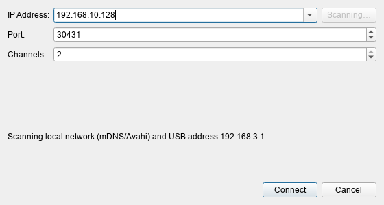
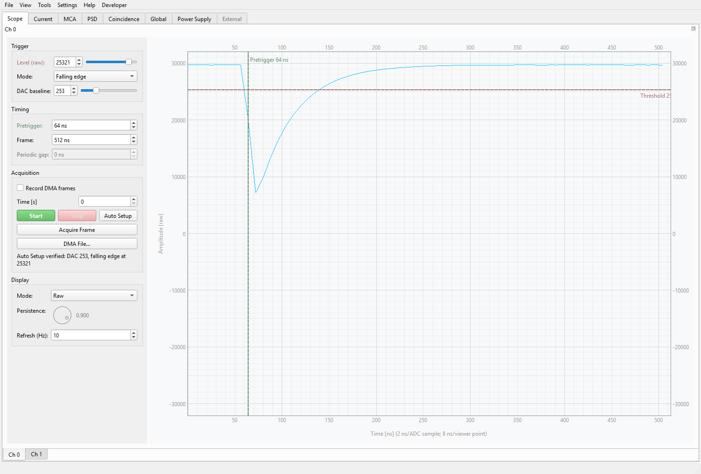
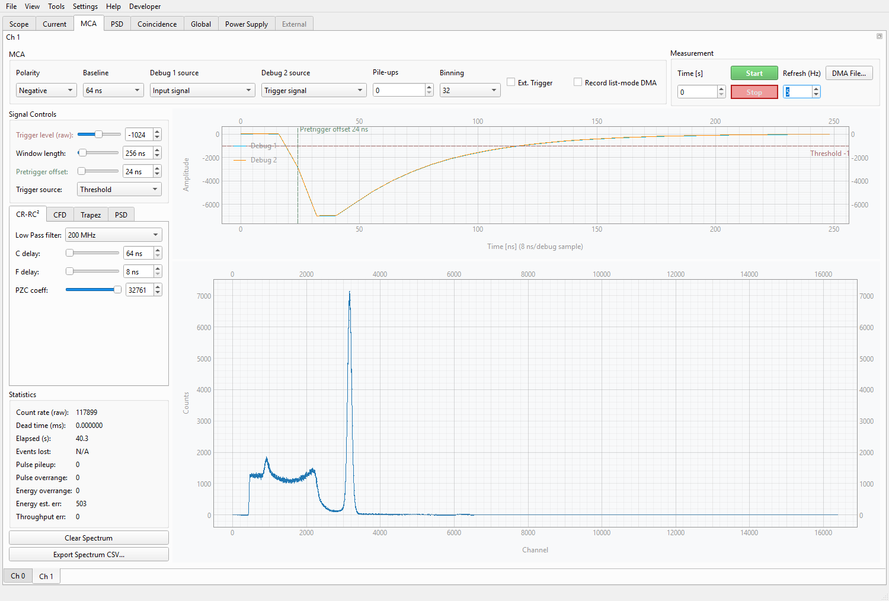

# Nuclear Lab Digitizer — Community Edition

[](LICENSE)
[](https://www.python.org/)

Nuclear Lab Digitizer is a PySide6 desktop application for acquiring and
analysing data from the Eastern Wall Technologies Digitizer 4.0. It combines a
two-channel oscilloscope, multi-channel analyser (MCA), pulse-shape
discrimination (PSD), high-voltage control, board diagnostics, and optional
Modbus instruments in one dockable interface.

The application uses the board's **direct Linux IIO interface**. It connects to
`iiod` with libiio and uses the board's IIO attributes and buffers for
configuration, live data, and DMA capture, normally on TCP port `30431`.

The legacy gRPC/ZMQ runtime was removed from the current codebase. Its final
supported snapshot is preserved on the
[`grpc-final`](https://github.com/nucliflare/nlab-digitizer-community/tree/grpc-final)
branch for boards that still run older firmware.

The task-oriented [documentation index](docs/Home.qmd) covers installation,
acquisition ownership, current and coincidence workflows, capture integrity,
offline analysis, troubleshooting, architecture, and development. These Quarto
sources are also rendered into the project wiki.

### In-app help

Press **F1**, then click a label or control to open its offline explanation.
The question-mark cursor indicates selection mode; **Esc**, F1 again, or a
right-click cancels. Selection clicks, wheel changes, and keyboard edits are
consumed rather than operating acquisition controls. Acquisition itself continues.
Help also works in owned settings and analysis dialogs, including disabled
controls. **Help → User Guide…** opens the searchable reference directly, with
Back/Forward navigation and related-topic links. Unmapped items explicitly open
their workspace guide; not every advanced control has an individual article yet.

The parameter reference is bundled with the app (including packaged builds),
so it needs no internet connection or Qt WebEngine. Its Markdown source in
`src/nlab/data/help/parameters.md` is also included in the
[wiki parameter reference](docs/context_help.qmd). Existing wiki workflow guides
remain available through an explicit external link; opening help itself does
not contact the network.

PSD and waveform tools keep instructions in tooltips and F1 topics instead of
permanent explanatory banners. Parameter names, numeric results, progress, and
fit-quality warnings remain visible. **Auto preview** still uses every twentieth
selected event while dragging and queues the normal reconstruction on release;
the exhaustive-search confirmation remains mandatory. The waveform signal-preview
legend defaults to the top-right and stays anchored there when resized.

Waveform displays use sample-hold steps: each level extends to the next sample
timestamp, with a vertical transition there instead of diagonal interpolation.
This applies to Scope raw/DMA/replay views and persistence, MCA debug signals,
both offline waveform traces, and Current's raw DMA fragments. Sample coordinates,
stored values, integration, and trigger/gate positions are unchanged. DMA fragment
gaps remain disconnected; scalar IIR/telemetry trends and fitted models remain
lines. Steps show the resolution of the displayed samples, not a reconstruction
of the analogue input; averaged/decimated previews retain their existing resolution.

## Choose a workflow

The [use-cases guide](docs/use_cases.qmd) maps measurement goals to entry
points, outputs, and interpretation limits. Common paths are:

| Goal | Workflow |
|---|---|
| Check a detector and collect a spectrum | Scope Auto Setup, then accumulated MCA |
| Calibrate energy and quantify peaks | MCA Energy Calibration, then Peak Analysis and report export |
| Record response against a known dose rate | Dose Calibration Logger |
| Qualify PSD separation | Live/readback PSD or waveform reconstruction, FOM fit, and optional gate optimization |
| Measure prompt coincidences | Same-digitizer Coincidence timing and energy matrices |
| Investigate startup gain drift | Dual-channel MCA gain-drift diagnostic |
| Review a run without hardware | Session recording/replay or standalone offline workbenches |
| Monitor independent boards together | Add Digitizer with per-board global controls |

## Main features

### Scope

- Live waveform viewer with level, edge, and periodic trigger modes
- A draggable dashed trigger-threshold line on the Scope plot, synchronized
  with the threshold slider and spin box; the hardware value is committed
  when the line is released
- A muted green dashed pretrigger marker, synchronized with the nanosecond
  control. Dragging it previews the horizontal waveform shift in 8 ns steps;
  releasing it updates hardware. The marker and threshold labels match their
  respective line colors.
- In the live raw waveform view, grab the trace to adjust pretrigger time
  horizontally (8 ns steps) and DAC baseline vertically. The trace is a
  frozen preview while dragging; settings are written on release, then the
  next acquired frame shows the actual signal. Auto Setup supplies a measured
  DAC sensitivity; without it, the vertical preview is approximate.
- Scope Auto Setup recognizes narrow, randomly arriving detector pulses and
  performs a bounded provisional-trigger search when its initial forced-frame
  survey contains only baseline.
- Configurable frame length, pretrigger position, frame gap, and analogue offset
- Persistence and raw display modes
- Full-resolution IIO DMA recording with capability-gated queued buffers,
  batched remote reads, bounded stop, tail drain, and recovery
- Independent viewing while a DMA capture is active

### Live current monitor

Each channel has a **Current** workspace with two acquisition modes. The
monitor starts stopped and opens no polling or DMA transport until **Start
monitor** is pressed.

| Mode | Source | Best suited for | Important constraint |
|---|---|---|---|
| **IIR polling** | Signed FPGA input-filter output | Lightweight continuous scalar monitoring | Host-timed reads; the requested 1 kHz spacing is not a hardware-time grid |
| **Scope DMA** | Complete timestamped Scope waveforms | Raw waveform inspection and sample-weighted interval statistics | Direct IIO only; owns Scope DMA while running |

Both modes retain a rolling ten-second numeric history and support the saved
linear calibration `(raw - zero) * scale`. IIR and DMA expose different raw
signals, so each sensor/front-end path must be calibrated appropriately before
the display can be interpreted as A, mA, uA, nA, or pA.

On IP122, Current DMA applies the qualified periodic preset (8,188 configured
samples, zero pretrigger, and a 100 us post-frame gap). Complete frames feed
the scientific accumulator before the replaceable GUI preview. The numeric
view is capped at 30 Hz and the waveform at 2 Hz, so display work does not
backpressure acquisition. While stopped, the workspace can change the DMA gap
or use **Reset Scope defaults** after the optimized preset.

See the [live current monitoring guide](docs/current_monitor.qmd) for the GUI
workflow, calibration semantics, ownership rules, diagnostics, and the minimal
headless IIR/DMA callback example. The same guide is published in the project
wiki. Run the example with:

```bash
uv run python examples/measure_current.py
```

### MCA and PSD

- The MCA debug viewer has draggable, dashed trigger-threshold and pretrigger-
  offset markers. Their muted red/green labels match the corresponding controls;
  the offset marker previews a horizontal shift of both debug traces, and
  hardware settings are applied on release.
- Pulse-processor, input-filter, CFD, charge-comparison, and trapezoid controls
- Live 16,384-bin spectra with logarithmic display, ROI statistics, and a
  **View** menu switch for monitoring only the counts added since the previous
  refresh; the same menu controls MCA ROI visibility and logarithmic Y scale.
  Hover over an MCA histogram and press `L` to toggle its scale. Exports and
  analysis snapshots retain accumulated counts. Double-click the MCA ROI to open a
  modeless count history against acquisition elapsed time; its values follow the
  accumulated or per-refresh differential histogram display mode
- Modeless multi-spectrum energy calibration under **Tools**, with draggable
  reference lines, linear or quadratic fits, residuals, per-channel calibrated
  top axes, and raw-channel-preserving CSV/YAML metadata
- A modeless dose-calibration CSV logger under **Tools** records a committed
  reference dose rate beside selectable MCA, PSD, bias-voltage, and temperature
  observables at a configurable interval
- Modeless MCA peak-analysis workbench under **Tools** with automatic frozen
  snapshots of current MCA spectra, CSV/ASCII SPE/Tukan WDM/CAEN TXT3/ROOT
  loading, one-to-three Gaussian fits, selectable count-aware backgrounds,
  residuals, parameter uncertainties, and variance-preserving spectrum
  arithmetic, plus evaluated radionuclide photon-line overlays for calibrated
  spectra
- Debug waveform-bank readout
- Synchronized stop/write/restart when changing MCA settings during acquisition
- List-mode IIO DMA using fixed 1,024-record frames
- Live PSD classification from charge-comparison and energy measurements,
  including interactive double-Gaussian projection fitting and conventional
  centroid/FWHM figure-of-merit reporting. Live and Tools/readback PSD maps,
  along with coincidence matrices, render bins containing zero or one count as
  transparent against the light plot background
- Per-measurement MCA output as NDMA, ROOT TTree, HDF5, or online-only DMA
- Incremental bounded-memory file writing with embedded/same-stem YAML settings
- Per-channel live record rate and end-of-run integrity summary; IIO driver
  frame/loss diagnostics are retained for every list-mode output format
- Two-channel IIO coincidence acquisition with automatic shared software
  start, MCA ROI energy gates, AND/veto/OR/XOR logic, and live timing and
  accepted-energy histograms. Qualified CFD timing uses exact 62.5 ps bins
  and reports a guarded constant-background Gaussian-core center, FWHM,
  uncertainty, fitted counts, and reduced chi-square.

### Instrument control

- Per-channel high-voltage output, feedback, and temperature monitoring when the
  IDS IIO devices are present
- Shared trigger control and board-wide diagnostic readings
- Startup and on-demand RS-485 device discovery through the board's ser2net
  bridges; **Connection → Refresh Modbus Devices** updates the External
  workspace without reconnecting the digitizer
- Support for SiPM bias, Geiger-Mueller, and PMT high-voltage Modbus devices
- Compact External workspace tables fill the control pane while keeping every
  column visible beside the live plot; hover an elided register label to see
  its full name
- Safe acquisition and power-supply shutdown when the application closes

### Application workflow

- **Help → About → Check for Updates** compares the installed version with the
  latest published stable release on GitHub. The check runs only on request,
  keeps the interface responsive, and offers a release-page link when an update
  is available. Downloads and installation remain manual.
- Dockable and floatable channel panels, including multi-monitor layouts
- Scope, Current, MCA, PSD, Coincidence, PSU, Global, External, and System Log
  workspaces
- Matching launch and connection-progress splashes, showing startup stages
  while channels and instrument views are initialized
- Save and restore hardware plus application settings in YAML
- Convert Scope and MCA binary captures to HDF5 from the File menu
- **File → Convert Binary to ROOT...** converts native NDMA Scope waveforms
  (v1) or MCA list-mode captures (legacy v1 and IIO v2) to ROOT TTrees without
  connecting to hardware. Conversion runs in the background with progress and
  cancellation; choose a new output filename (existing files are never overwritten).
  The `events` tree retains all raw list-mode fields and their integer types;
  the `waveforms` tree stores one `uint64` timestamp and a fixed-length `int16`
  `samples` array per frame. No records, including all-zero padding, are filtered.
  `metadata_json` stores the source SHA-256, channel, recording time, format
  version, geometry, and units. Available configuration YAML and authenticated
  IIO JSON capture metadata (including continuity diagnostics) are embedded too.
  Waveform samples use integer sample indices: NDMA v1 does not store sampling
  period/decimation, so conversion does not invent a physical sample-time axis.
  Incomplete records/frames, unsupported versions, mismatched IIO sidecars, and
  source files changed during conversion are rejected; cancelled/failed exports
  remove their incomplete output. Stop a recording before converting it.
- Remote board reboot and shutdown controls
- A dedicated **Connection** menu for connecting an offline workspace, adding
  digitizers as extra channels, reconnecting all live endpoints, and running
  background external Modbus rescans. Add Digitizer resolves hostnames and IP
  addresses before opening a channel, so the same board cannot be added again
  through an Avahi/mDNS alias.
- An explicit **Offline / Replay Mode** in the startup dialog that opens the
  analysis workspace without IIO or Modbus hardware, keeps all hardware
  controls locked, and supports recorded Scope, Current, MCA, PSD, coincidence,
  PSU, global-diagnostics, temperature-correction, and external-module playback
- Persistent layout, connection, plotting, and developer settings
- Central **General Settings** controls for Scope display/refresh, MCA refresh,
  PSU monitoring history, acquisition destinations/formats, and histogram views
- Optional **Settings → General Settings...** snapshot of the complete Scope,
  MCA, and Power Supply configuration, saved on clean exit and restored at the
  next startup. Snapshots are kept separately for each connected device IP, and
  an explicit `--config` file takes precedence. See the
  [General Settings ownership review](docs/general-settings-candidates.md) for
  the centralized controls and the hardware operations that remain channel-local.

### Session recording and deterministic analysis replay

Use **File -> Start Session Recording...** to create a versioned
`.nlab-session` directory. Recording is passive: it does not start or reconfigure
an acquisition. While active, it saves the measurements the application already
observes, including MCA list-mode events and histogram/debug/statistic
checkpoints, Scope viewer and full DMA frames, IIR current samples, PSU/global/
external telemetry, and application logs. A complete hardware and application
configuration is saved at the start, with a final configuration snapshot in the
timeline.

Each bundle contains:

- `manifest.json`: format/application versions, session ID, UTC and monotonic
  timing, per-stream counts, drop/error reasons, completion state, and SHA-256
  hashes of immutable capture members;
- `configuration.yaml`: the initial settings snapshot;
- `streams.h5`: append-only numerical streams and committed-record counters;
- `timeline.jsonl`: ordered host timestamps, telemetry, commands, status, and
  log records;
- `annotations.yaml`: a deliberately mutable ML-label template for sample ID,
  isotope truth, background status, detector ID, geometry, shielding,
  environment, split group, and notes. It is excluded from capture hashes so
  labels can be curated without invalidating the original measurement.

**File -> Stop Session Recording** drains complete accepted records before
atomically marking the bundle complete. A crash or storage/consumer overflow is
therefore visible as an incomplete or invalid session rather than a silently
truncated valid capture. Existing session directories are never overwritten.

**File -> Replay Session...** verifies finalized content hashes and reconstructs
one MCA spectrum per channel in the peak-analysis workbench. List-mode replay
uses the capture-derived `trapezoid_energy >> 2` mapping and discards only
all-zero DMA padding; when list-mode data are absent it uses the final recorded
hardware histogram checkpoint.

Recorded MCA polling checkpoints are replayed into the normal MCA histogram,
debug-waveform, and statistics views at their captured host timing, so
accumulation is visible rather than appearing only as a final spectrum. Recorded
list-mode batches progressively feed each channel's PSD matrix and projections.
If both coincidence channels were captured, those same batches progressively
rebuild the timing histogram, participant spectra, and prompt/random energy
matrices using the saved coincidence, ROI, and MCA-binning settings. New bundles
store explicit list-mode batch timing; older bundles fall back to complete DMA
frame boundaries and hardware timestamps. Replay never rearms MCA DMA or the
shared trigger.

MCA/list-mode replay reads and analyzes batches in a background thread. Every
recorded batch is processed in order; only display snapshots are coalesced (at
most 10 updates per second), so changing tabs remains responsive. Hidden PSD and
coincidence plots redraw the latest state when shown. PSD bin/range edits also
recompute in the background, including after EOF; replay retains the PSD event
batches needed for that re-analysis until it is unloaded. Exiting replay or
loading another session cancels and joins the analysis worker before restoring
the views. Read/analysis errors are logged and shown in the bottom status bar.

Recorded Scope frames, IIR Current samples, and timestamped PSU/global/external-
module telemetry play once at their captured host timing from one shared replay
clock. The exact Scope viewer stream is preferred, with complete DMA frames used
when no viewer frames exist for a channel. Loading replay stops Scope, MCA, and
Current acquisition, stops live PSU, global-diagnostic, and external polling,
and suspends the automatic temperature-correction writer. Late Scope updates
are coalesced to the newest due frame; every due telemetry update is delivered
in order. At EOF the last recorded waveform and telemetry values remain
displayed. Playback never loops or silently falls back to live data, and exiting
replay leaves acquisition stopped while restarting background monitoring only
when it was active before replay.

Large numerical streams are consumed lazily from HDF5 rather than materializing
the complete capture up front. Scope, MCA polling, and Current retain only their
current frame/readback or sample window; PSD retains processed batches for
re-binning as described above. External-module register schemas
(units, scaling, ranges, and register types) are saved with new sessions, and a
configured module still appears in offline replay even if it produced no
telemetry. Older bundles remain supported through value-based schema inference.
If an offline workspace has fewer channels than the bundle, loading stops with
an explicit channel-count message instead of silently omitting recorded views.

This is deterministic *analysis replay*: recorded commands are not sent back to
the digitizer, and it cannot reproduce analogue noise, environmental conditions,
or unobserved device state. A persistent status-bar badge and a `[REPLAY]`
window-title suffix identify the mode across the application. Every widget and
menu action capable of changing hardware is disabled while replay is loaded,
including Scope, MCA, Current, PSU, shared-trigger, coincidence, external-device,
settings-load, reconnect, and board-power controls. PSU, Global, and External
views show recorded telemetry rather than live polling. Use **File -> Exit
Replay Mode** to unload all reconstructed
analysis and playback. For ML use, fill in `annotations.yaml` and use
`split_group` to keep measurements from the same physical source/setup together
during train/validation/test splitting.

Replay does not require a connected digitizer. Select **Offline / Replay Mode**
in the startup connection dialog, then use **File -> Replay Session...**. The
application opens no IIO or Modbus transport, marks the whole window `OFFLINE`,
constructs read-only analysis targets for the selected channel count, and builds
external-module panels from the fields stored in the bundle. File-based waveform,
PSD, calibration, and peak-analysis tools remain available. To acquire data or
change hardware without restarting, choose **Connection -> Connect...**, select
the endpoint and channel count, and connect. The live controls replace the
read-only channel workspace after every requested IIO channel opens successfully.
Once live, the same action becomes **Add Digitizer...**. Each added endpoint is
opened completely before the workspace is rebuilt, and channels are labelled by
physical source (`D1:CH0`, `D1:CH1`, `D2:CH0`, and so on). Global trigger and
diagnostic controls remain separate for each board. Coincidence acquisition uses
two eligible channels from one board only; cross-board synchronization is left
disabled until it can be validated in hardware. **Connection -> Disconnect
Digitizer...** removes a selected board, renumbers the remaining `D#` labels, and
returns the application to offline analysis mode when the final board is removed.
Connect, add, disconnect, and reconnect prepare the replacement topology before
committing it; if transport preparation, teardown, or view reconstruction fails,
the application restores the previous consistent workspace.

## Hardware and firmware requirements

For the recommended IIO path, the board must run a firmware and Linux image
that exposes the relevant devices through `iiod`.

| Function | Expected IIO device |
|---|---|
| Scope control, viewer, and DMA | `vdpp_scope` |
| Scope analogue offset | `vdpp_afe_dac` |
| MCA control and histogram | `vdpp_pulse_processor` |
| MCA input filter | `vdpp_input_filter` |
| MCA list-mode DMA and PSD | `vdpp_lm_frame` |
| Shared MCA trigger | `vdpp_sync_trigger` |
| IDS/HV and diagnostics | `ad5686r`, `mcp3564`/`mcp3564r`, `tmp117`, and optional diagnostic devices |

Scope remains available if MCA or IDS devices are absent. The GUI disables the
workspaces that the detected firmware cannot support instead of failing the
whole connection.

The standard project configuration uses:

- IIO/iiod: TCP port `30431`
- Optional ser2net bridges: TCP ports `5001` and `5002`

The board address is deployment-specific. Examples below use
`192.168.10.128`; older images commonly used `192.168.10.20`.

### Check the IIO endpoint

Install the libiio command-line tools and inspect the remote context before
troubleshooting the GUI:

```bash
iio_info -u "ip:192.168.10.128:30431"
```

Confirm that the expected device names are present for every requested
channel. Current MCA and list-mode drivers expose `channel_index` for stable
pairing. Scope and input-filter instances without that attribute use sorted
`iio:deviceN` order as a compatibility fallback, so verify physical A/B mapping
after a firmware or device-tree change.

### List-mode firmware compatibility

Current list-mode support requires `vdpp_lm_frame` IP version 121 with:

- `frame_records=1024`
- `frame_bytes=16384`
- `record_layout=opaque[16]`
- one repeated-u8 scan element carrying each 16-byte record unchanged

Older list-mode firmware may expose five semantic scan channels. That ABI is
not compatible with the Linux 5.15 IIO timestamp handling used by the target:
buffer allocation fails immediately with target-side `EINVAL` (`Open unlocked:
-22`), including with the official `iio_readdev` utility. Upgrade the target
driver/firmware to the opaque-record ABI; do not change the Python frame length
or request a partial scan mask as a workaround.

## Installation from source

### Prerequisites

- Python 3.12 or newer
- [`uv`](https://github.com/astral-sh/uv)
- The platform-appropriate IIO drivers and native runtime from
  [Analog Devices libiio v0.26](https://github.com/analogdevicesinc/libiio/releases/tag/v0.26)
- The `pylibiio` Python package, installed automatically with the project
- Qt runtime libraries; Python Qt bindings are installed through PySide6

On Linux, the system may also need the OpenGL, EGL, XKB, and XCB libraries used
by Qt.

On Windows, a packaged application detects a missing or unloadable native
libiio runtime before importing the hardware UI. It shows an actionable dialog
with a button to the pinned v0.26 release instead of exposing a frozen-
application traceback. Install `libiio-0.26.ga0eca0d2-setup.exe` from that
release and restart the application.

The host application currently uses the libiio 0.x Python and streaming APIs.
Libiio 1.0 deliberately breaks that API and ABI, including context discovery,
attribute access, channel masks, and buffer streaming. The 1.0 distribution can
build a v0.x compatibility library and a v0.26 client remains wire-compatible
with a 1.0 IIOD server. The application nevertheless rejects a host runtime
reporting major version 1 and remains pinned to v0.26 until the compatibility
layer and DMA lifecycle are validated on the supported Windows and target
configurations. This does not prevent connecting the v0.26 host client to a
target running a backward-compatible 1.0 IIOD server.

### Set up the project

```bash
git clone https://github.com/nucliflare/nlab-digitizer-community.git
cd nlab-digitizer-community

uv sync --locked --extra dev

python scripts/build_ui.py
```

The generated Qt modules are intentionally not committed. Generate them after
a fresh clone and whenever a Qt Designer form or resource changes.

## Running the application

```bash
uv run nlab
```

In the connection dialog:

1. Select a discovered board or enter its address, for example `192.168.10.128`.
2. Use port `30431` unless the target's `iiod` configuration differs.
3. Select the number of channels exposed by the board and connect.

To work without a board, select the desired channel count and click
**Offline / Replay Mode** instead. The analysis workspace opens no hardware
endpoint; live acquisition, session recording, hardware settings, reconnect,
Modbus refresh, and board-power actions remain disabled. Analysis tools and
**File -> Replay Session...** remain available. **Connection -> Connect...**
opens the same discovery dialog later and promotes the running offline workspace
to a live measurement session without restarting the application.

When opened, the dialog scans for network `iiod` services with libiio's
DNS-SD/mDNS discovery (Avahi on Linux) and also probes `192.168.3.1:30431`, the
fixed address used by the board's USB network connection. **Rescan** repeats
both checks without blocking the window. Manual addresses remain supported,
and the dialog remembers a successful selection. A port saved by an older IIO
installation is migrated; the obsolete gRPC default is not reused.

A saved configuration can pre-fill the address, port, and channel count, while
explicit address options override values from the file:

```bash
uv run nlab --config experiment.yaml --ip 192.168.10.128 --port 30431
```

You can also run the module directly:

```bash
python -m nlab.main
```

### MCA startup gain-drift diagnostic

`examples/mca_gain_drift_diagnostic.py` records a repeatable dual-channel
startup trace for a known photopeak. It applies the host's latest auto-saved
MCA configuration by default, starts fresh histogram acquisitions, and tracks
both the literal and smoothed differential-spectrum maximum in an inclusive
ROI. The command also records a local centroid, MCA statistics, available HV
feedback, detector/HAT/FPGA/ADC temperatures, input-filter temperature
correction, clock/rail diagnostics, and standard board-input hwmon telemetry.

```bash
uv run python examples/mca_gain_drift_diagnostic.py \
  --host 192.168.10.135 --duration 180 --interval 2 \
  --channel-roi 0 3500 4250 --channel-roi 1 1000 1700 \
  --apply-saved-psu
```

Both MCA channels must be idle before the command starts. Scope settings are
never written. PSU settings are monitor-only by default; the explicit
`--apply-saved-psu` option applies each channel's saved bias and requests a safe
HV shutdown after the capture, including on errors. The original MCA state is
restored after the capture. Use repeated `--channel-roi CHANNEL MIN MAX`
arguments when the two calibrated peaks occupy different raw-channel ranges.
The timestamped output directory contains sample telemetry as CSV, every
differential ROI spectrum as compressed NPZ, early/late and time-series PNG
plots, the exact saved YAML configuration, and JSON metadata/summary. An
internal HV readback is informative only when that supply actually biases the
detector; retain the external supply's own log when PMT bias is external.
For an A/B check between acquisition startup and detector/base settling, add
`--bias-settle SECONDS` with `--apply-saved-psu`; the saved bias is then held
for that interval before either MCA starts.

### First live measurement: Cs-137

The screenshots in this walkthrough contain **live hardware data**, not a
generated or simulated spectrum. They were captured from the reference board
at `192.168.10.128:30431` with a Cs-137 source on both detector channels
(Scope IP v122, MCA IP v101). Detector bias had already been prepared outside
this workflow, so the application did not read or change either PSU channel.

Follow your laboratory's rules for detector bias and radioactive-source
handling. Do not copy an HV setting from a screenshot or assume that skipping
the Power Supply tab means a detector is unpowered.

1. Start the application, enter `192.168.10.128`, leave port `30431`, select
   **2** channels, and click **Connect**.

   

2. Open **Scope** and select the channel you want to measure. Ensure ordinary
   acquisition is stopped and **Record DMA frames** is clear, then click
   **Auto Setup**. Auto Setup measures the baseline, chooses the DAC offset,
   trigger level, and edge, and finally verifies the trigger against a fresh
   pulse. A successful result ends with `Auto Setup verified` and a clean
   inverted pulse similar to this live Ch0 frame:

   

3. Click **Stop** before moving to MCA. Repeat Auto Setup for the other channel
   if you will measure it too; channel settings are independent.

4. Open **MCA** for the same channel. For this reference setup, select
   **Negative** polarity, **Threshold** trigger, raw trigger level `-1024`, and
   binning `32`. Binning 32 keeps the complete pulse-height distribution
   inside the 16,384-channel plot on both inputs. Click **Start**, allow the
   spectrum to stabilize, then click **Stop** before changing channels or
   configuration.

   Ch0 placed the uncalibrated Cs-137 full-energy photopeak near channel 4448:

   

   Ch1 placed the same photopeak near channel 3168:

   

The two raw channel positions differ because the channels have different
uncalibrated gains. In both plots the single narrow full-energy peak is the
approximately 662 keV Cs-137 line; the broader low-energy structure is the
expected continuum and does not represent a second photopeak. Calibrate the
energy axis before reporting energy values from an unknown spectrum.

## Programmatic IIO access

The hardware layer can be used without the GUI. IIO channel numbers are
zero-based.

```python
from nlab.hardware.digitizer import Digitizer

digitizer = Digitizer.from_iio(
    channel=0,
    uri="ip:192.168.10.128:30431",
)

try:
    digitizer.scope.set_trigger_level(5000)
    digitizer.scope.set_frame_samples(1024)
    frame = digitizer.scope.acquire_frame()

    if digitizer.capabilities.mca:
        digitizer.mca.set_energy_bin(4)
        digitizer.mca.start()
        spectrum = digitizer.mca.acquire_spectrum()
        digitizer.mca.stop()

    if digitizer.hv is not None:
        digitizer.hv.set_hv_voltage(800.0)
        print(digitizer.hv.get_hv_adc_voltage())
finally:
    digitizer.scope.stop()
    if digitizer.capabilities.mca:
        digitizer.mca.stop()
    digitizer.close()
```

Pass `with_ids=False` to `Digitizer.from_iio()` when only Scope/MCA access is
needed. If required IDS devices are missing, construction logs a warning and
continues with `digitizer.hv` set to `None`.

`digitizer.capabilities` is the immutable feature snapshot discovered at
connection time. It reports Scope DMA, MCA, MCA list-mode DMA, and IDS/HV
availability without requiring callers to inspect backend types.

For a headless periodic Scope DMA recording, use the direct-IIO example:

```bash
uv run python examples/dma_scope_periodic.py capture.bin --duration-s 10
```

It defaults to channel 0 at `192.168.10.128:30431`, Periodic trigger,
16,376 ns frames (8,188 samples), 1,000 ns gap, Raw NDMA output, and DMA on.
Without `--config`, it runs Scope Auto Setup to calibrate the DAC and trigger
threshold before switching to the requested trigger mode. A GUI v4 settings
YAML or a single-channel YAML with `scope.dac_value` and
`scope.trigger_level` skips Auto Setup; YAML frame/gap/mode values apply unless
overridden by `--frame-ns`, `--gap-ns`, or `--trigger-mode`. For example:

```bash
uv run python examples/dma_scope_periodic.py capture.bin --config scope.yaml --frame-ns 16376 --gap-ns 1000 --trigger-mode periodic
```

The example records for 10 seconds by default, refuses to overwrite an
existing file or take over an active Scope, and restores the original Scope
settings after capture. A time-based progress bar shows complete frames
written and the current logical file size (including the NDMA header).
It has no GUI display; `--display-mode raw` and
`--dma on` name the only supported output path. A 10-second maximum-frame
recording may use roughly 330 MB. Inspect the NDMA result with
`notebooks/check_dma.py`.

That file workflow requires a Scope record layout compatible with NDMA v1.
Deployed v122 firmware advertises a decimated, alignment-padded layout in
Periodic mode, which NDMA v1 cannot describe. The client therefore rejects a
v122 Periodic file capture explicitly instead of writing a misleading file;
the Current workspace's online Scope DMA mode supports that layout. A future
versioned Scope file format is needed before those records can be saved.

Boards that still require the removed gRPC services must use the preserved
`grpc-final` branch. Settings files that explicitly select `backend: grpc` are
rejected by this branch so they cannot be applied accidentally over IIO.

## Capture files and analysis

Scope recording remains binary with an `NDMA` header. Scope files are not
rotated at an application-defined size; the GUI reports KiB, MiB, or GiB while
the same file grows until recording stops or storage reports an error. The
v122 Periodic-layout restriction described above applies. MCA
list-mode output is selected under **Settings → General Settings...** and creates a
new file for every measurement. Available modes are binary NDMA, a ROOT
`TTree`, appendable HDF5 with SWMR metadata, and online-only DMA with no file.
Binary, ROOT, and HDF5 save list-mode events whether or not Charge Comparison
is enabled. With Charge
Comparison enabled, DMA also feeds the live PSD view when available. Online-only
DMA with Charge Comparison disabled feeds live coincidence analysis when a
coincidence run owns the channels; otherwise the events are discarded. All file formats are written
incrementally through a bounded queue rather than accumulated in RAM.

### MCA energy calibration

The workspace's **File**, **Analysis**, **View**, and **Help** menus replace the
command buttons. **File** copies/replaces or overlays the current MCA spectrum,
downloads reports (**Ctrl+S**), and closes the workspace (**Ctrl+W**).
**Analysis** adds/removes/clears points and applies or clears calibration; the
existing automatic refitting, validity checks, and unapplied-edit confirmation
are unchanged. **View** resets plot zoom and **Help** opens the bundled guide.
Channel/model/width controls and the calibration table stay beside the plots.

Open **Tools → MCA Energy Calibration...**, choose an MCA channel, and copy its
current spectrum into the calibration workspace. Double-click a known peak to
add a draggable reference line, then enter its expected energy in keV. The
line position is an initial peak seed, not the calibration coordinate itself.
After a drag completes, the tool fits a Gaussian plus linear background within
the selected centroid half-width, which defaults to 300 channels; a solid marker
and the **Centroid ch.** column show the fitted position used by the energy
calibration. The seed can also be edited numerically. At least two enabled
references are required for a linear
least-squares fit and three for a quadratic fit; the table reports each residual
and the tool reports RMS and maximum residuals. A failed local peak fit prevents
application rather than silently falling back to the seed position.
Applying the calibration snaps each draggable seed line to its fitted centroid
and overlays the corresponding local Gaussian fit on the source spectrum, with
an aligned lower plot of observed-minus-fitted count residuals. A subsequent
point, model, fit-width, or spectrum edit hides these applied-fit overlays and
residuals until the revised calibration is applied.

Use **Add current as overlay** after changing radioactive sources to combine
lines from several spectra. Existing points remain in place. Overlays are
accepted only when their MCA binning, polarity, low-pass, and trapezoid settings
match. A spectrum copied during acquisition is labelled as a live, non-atomic
snapshot because histogram chunks are transferred sequentially while counts may
still change.

Applying a calibration does not modify FPGA registers, histogram bins, ROI
coordinates, or raw list-mode records. The MCA histogram keeps raw channels on
the bottom axis and displays calibrated keV on the top axis. ROI statistics and
CSV exports include calibrated values, and Save Settings plus subsequent capture
metadata preserve the reference points, coefficients, fit residuals, and energy-
processing fingerprint. While any MCA calibration is applied, a persistent
**ENERGY CALIBRATED** badge in the bottom status bar lists the calibrated channels
in its tooltip; double-click the badge to reopen the calibration workspace. If a
relevant MCA setting changes, the top axis is
marked stale until the original settings are restored or a new calibration is
applied. Binning is handled specially: changing its power-of-two factor
automatically rescales the channel coordinates, so a calibration made at (for
example) binning 16 remains valid at binning 32 or 8. Other energy-processing
changes still mark the calibration stale.

After a valid fit, **Download report...** creates a uniquely named report folder
with a branded two-page PDF, all copied source spectra, the draggable seeds and
Gaussian centroid-fit curves and their count residuals, calibration points and
energy residuals, plus complete JSON metadata. The PDF typesets the Gaussian
centroid and linear or quadratic energy-calibration equations in mathematical
notation.

### Dose calibration CSV logger

Open **Tools → Dose Calibration Logger...**, select one detector channel, enter
the known source/setup and expected dose rate, and choose a new CSV file. The
reference dose is committed only when editing its field finishes, so a partially
typed value cannot leak into timer-driven rows. Every row contains its UTC time,
actual interval, channel, source label, committed dose value, and dose unit.

The optional column groups capture the latest already-polled values without
performing additional hardware reads or starting an acquisition:

- MCA raw count rate, pulse dead time, and acquisition elapsed time;
- total counts added between consecutive accumulated MCA spectra, plus the
  integral inside the MCA ROI when that ROI is visible;
- HV and optional SiPM setpoints and voltage readbacks;
- analogue/digital detector, ADC, HAT, FPGA, and raw ADS5407 temperatures;
- cumulative PSD energy-spectrum integrals below and above the current cut,
  both over the full displayed energy range and inside the selected PSD energy
  ROI. The current cut and ROI bounds are repeated in every row.

The first accumulated MCA spectrum at **Start CSV recording** establishes the
differential baseline; rows remain blank for data that have not yet produced a
live readback. The adjacent live plot can display any enabled numeric CSV field,
including the user-entered expected dose rate, against recording elapsed time.
Each row is flushed immediately, and an existing CSV is never overwritten.
Closing the tool, disconnecting a digitizer, or rebuilding the workspace closes
the file cleanly.

### MCA peak-analysis workbench

The workbench has **File**, **Analysis**, **References**, **View**, and **Help**
menus in place of command-button rows. **File** handles spectrum loading/exports,
fit exports, reports, and closing; **Analysis** refreshes/removes snapshots,
suggests/fits peaks, cancels fits, and creates derived spectra using the visible
operation settings. **References** manages favourites/defaults and clears selected
reference lines. **View** selects linear/log counts, selects the side-panel tab,
and resets plot zoom; counts scale and tab selections remain synchronized with
their visible controls. **Help** opens the bundled peak-analysis guide.
Window-local shortcuts: **Ctrl+O** loads files, **Ctrl+S** downloads the report,
and **Ctrl+W** closes the workspace. Parameter fields remain next to the plots.

Open **Tools -> MCA Peak Analysis Workbench...** to copy the latest presented
spectrum from every available MCA channel. These are frozen analysis snapshots:
**Refresh selected MCA** or **Refresh all MCA spectra** copies newer data, but
the workbench never starts, stops, clears, or reconfigures acquisition. A copy
taken while acquisition is running is identified as live and non-atomic for the
same reason as the calibration workspace.

The workbench also loads NLab or ordinary delimited CSV spectra,
Maestro/ORTEC-style ASCII `.Spe` files, legacy binary Tukan `.wdm` spectra,
CAEN calibrated ASCII `.txt3` exports, and CAEN ROOT energy histograms. It
also validates and imports ANSI/IEEE N42.42 `.n42`/`.xml` documents; every
`Spectrum` becomes a separate workbench entry, including `CountedZeroes`
channel data, real/live times, detector and instrument identity, and polynomial
or energy-boundary calibration. Validation uses the bundled NIST base and
add-in schemas offline, ignores instance schema-location hints, rejects XML
entities, and checks the supported spectrum/calibration reference semantics.
accepts counts-only CSV, channel and counts columns, or channel/energy/counts
columns. A ROOT file contributes every `TH1` object from its `Energy` directory
as a separate spectrum, including empty channel histograms; unrelated Time/PSD
objects are omitted. CAEN calibration coordinates and real/live measurement
times are retained when the source represents them. CAEN `_F_` and `_R_`
histogram prefixes are recorded as filtered and raw provenance respectively.
The documented fixed
Tukan metadata includes the analyzer identity, spectrum description,
acquisition start time, and real/live measurement times. The undocumented
variable Tukan calibration/ROI tail and opaque CAEN ROOT calibration objects
are not guessed or applied. Visible spectra can be overlaid when they share
channel or energy coordinates; spectra using another axis are not silently
resampled.

The **Reference lines** tab overlays evaluated photon energies from a pinned,
offline NNDC ENSDF snapshot. The bundled 12.97 MiB SQLite catalogue contains
2,065 decaying parent nuclides/states and 87,481 default-quality lines from the
ENSDF data generated on 2026-08-10. It is generated at release time rather than
queried over the network, so the same application version produces the same
overlay offline. Na-22's evaluated 511 keV positron-annihilation feature is an
explicit DDEP/IRDFF-II supplement because annihilation radiation is not an
ENSDF nuclear gamma-transition record.

Select one or more parent nuclides and a minimum absolute emission probability.
The overlay works with a native keV axis or the selected spectrum's retained
channel-to-energy calibration; it is hidden when the calibration is absent or
stale. ENSDF relative intensities are converted to photons per 100 parent decays
using the dataset's photon normalization and branching ratio. Limit-only and
uncertain records remain in the database for provenance but are excluded from
the default overlay. Common laboratory sources are starred and pinned to the
top on first use; highlight any catalogue entry to add or remove it from the
persistent favourites, or restore the common defaults. **Only nuclides with
lines in fit ROI** converts the explicit fit region to keV and shows candidate
parents ranked by matching-line count and strongest emission probability, with
matching favourites pinned first; favourites without an ROI match remain
excluded. Text search and the probability threshold continue to apply. The plot
viewport is deliberately not used, so zooming and panning do not silently
change the candidate list. A line match is not presented as an isotope
identification.

Detector efficiency, geometry, attenuation, coincidence summing, and dead time
still determine the measured peak height. The catalogue does not currently
synthesize characteristic X-ray lines or annihilation lines for positron
emitters other than Na-22. JSON fit exports snapshot the selected nuclides,
catalogue version and source-release timestamp, probability threshold, ROI
candidate-filter state, and exact displayed reference records for
reproducibility.

Maintainers can reproduce the committed database with
`python scripts/build_radionuclide_catalog.py`. The builder refuses an
unexpected ENSDF release timestamp until it is reviewed and explicitly pinned.

Select one, two, or three Gaussian components and a background of none,
constant, linear, centred exponential, an error-function Compton step, or a
logistic Fermi step. Draggable markers seed and bound the peak centres. Raw
non-negative count spectra default to a Poisson-deviance fit; scaled,
background-subtracted, or otherwise derived spectra use their propagated
variance. Results include channel and calibrated-energy centroids, FWHM,
integrated area, resolution, parameter uncertainty, reduced fit statistic,
AIC/BIC, component curves, residuals, and boundary/covariance warnings.

Spectrum operations create new immutable entries rather than changing their
sources. Available operations are scalar scaling, area/maximum/acquisition-time
normalization, addition, subtraction, live- or elapsed-time-scaled background
subtraction, integer rebinning, and cropping to the fit range. Arithmetic
requires identical coordinate grids, propagates variance, and never performs
implicit interpolation. Spectra export to CSV or N42.42; fit summaries export
to JSON, CSV, or N42.42 without overwriting existing files. N42 export requires
positive real/live time and a current energy calibration, rejects negative
derived counts and stale calibrations, and records known instrument/endpoint
identity without inventing detector material or geometry. A fit N42 document
contains both the measured spectrum and `SpectrumPeakAnalysisResults` with
calibrated centroid, FWHM, net area, and area uncertainty. After a completed fit, **Download
report...** creates a non-overwriting folder with a branded two-page PDF of the
spectrum, fitted components, residuals, peak results, statistics, and typeset
Gaussian, FWHM, and selected-background equations, together with full fit-curve,
peak, parameter, and JSON metadata files.

### Live coincidence measurement

The **Coincidence** tab requires two current-IIO MCA list-mode channels and
the shared software-start core. When multiple connected digitizers qualify,
use the **Digitizer** selector to choose one board's channel pair; cross-board
coincidence remains disabled. Set the energy ROIs in the two MCA histograms,
then select **Use CH0/CH1 MCA ROI** in the coincidence view. A hidden ROI, or
an unchecked Use ROI option, accepts the channel's full MCA-channel range.
Each accepted-energy plot shows its MCA ROI as a dashed, shaded band; an
unchecked Use ROI option leaves a muted reference outline without applying
the gate. The band follows MCA ROI dragging and disappears when that ROI is hidden.
The ROI and accepted-energy plots use MCA histogram-bin units. Current IIO
list-mode records map their 16-bit selected-energy field to a 14-bit MCA
channel with `energyRaw >> 2`, **not** by shifting again by the MCA binning
selector. The producer may select trapezoidal or integration energy according
to its configuration. This fixed mapping matched paired saved captures with
different binning settings, but is not specified by the opaque-record IIO
driver and should be checked with a labelled-source capture on new firmware.
The accepted-energy plots remain in raw MCA channels.

`CH0 AND CH1` emits every pair inside the inclusive timing gate. An event may
participate in several pairs; the GUI reports pair count separately from the
unique participating-event counts and reports CH0 anchors with multiple
partners. A channel's **NOT** checkbox
with AND makes the other channel an anti-coincidence anchor: `NOT CH0 AND CH1`
accepts a CH1 event only if no ROI-qualified CH0 event falls in its timing
window. NOT does not invert the energy ROI. `OR` shows the union of eligible
singles; `XOR` shows eligible singles with no opposite-channel event in their
window. Both-NOT and NOT with OR/XOR are deliberately unavailable.

Ordinary `CH0 AND CH1` analysis also fills a 512x512 energy-correlation matrix.
Rows are CH1 and columns are CH0; each matrix bin spans 32 raw MCA channels.
The bottom and left axes remain raw channels, while applied MCA calibrations
provide CH0 and CH1 keV labels on the top and right axes. Movable vertical and
horizontal gates project the selected CH1 and CH0 populations respectively;
these display gates do not change acquisition or the prompt-pair count.

The matrix view can show prompt pairs, delayed-random pairs, or prompt minus
scaled random. Random estimation uses two non-overlapping delayed sidebands,
each equal in width to the prompt timing gate, with a configurable gap. Their
combined matrix is multiplied by 0.5 before subtraction. Linear and logarithmic
colour scales are available; corrected matrices use a sign-preserving
`sign(count) * log10(1 + abs(count))` transform in logarithmic mode. The current
prompt, random, and corrected matrices can be exported without overwriting an
existing file to HDF5 or ROOT together with raw-channel edges, gate settings,
timing configuration, calibration metadata, and session diagnostics. Matrix
analysis is deliberately unavailable for veto, OR, and XOR modes because those
modes do not produce two-member coincidence pairs.

The signed raw difference is CH1 event time minus CH0 event time. The measured
CH1-minus-CH0 common-input delay is then **subtracted** as a calibration. Timing
bounds and calibration accept decimal nanoseconds and are converted to exact
integer coordinates; displayed gate bounds are inclusive. AND plots the pair-
delay histogram. Veto, OR, and XOR have no delay for accepted unpaired events,
so the top panel instead plots accepted counts versus elapsed time. The lower
plots show unique participating CH0 and CH1 events. Changing an ROI, rule, or
timing bound resets only live analysis; raw recording continues.

The IIO driver exposes only `opaque[16]`. The GUI therefore uses the one
qualified producer profile, `vdpp-zc-calc-q2.14-v1`, without presenting an
unusable schema selector. The profile name remains in capture/session metadata;
IP121 alone does not identify it. Precision defaults to **Coarse (8 ns)**;
fine mode must be selected explicitly and requires CFD on both MCAs. Fine event
coordinates follow the PetaLinux contract exactly:

```text
eventTime_ns = 8 * timestampTicks
             + 2 * (uint8(zcOffset) + int16(fineRaw) / 16384)
```

`fineRaw` must be in [-16384, 0]. PSD marker `0x08` takes priority over CFD
marker `0x02`; ineligible or out-of-range records are counted and excluded.
Timing arithmetic remains integer in units of 1/8192 ns until bounded display
differences are formed, so uint64 timestamps above 2^53 retain adjacent ticks.
The delay histogram uses exact 62.5 ps bins. With at least 100 pairs and a
significant local peak, the GUI overlays a constant-background Gaussian-core
fit and reports its center, FWHM and formal uncertainty in picoseconds, fitted
signal count, and reduced chi-square. A reduced chi-square above 3 is labelled
non-Gaussian/poor fit; the displayed core width is not automatically a complete
detector CTR characterization.

`zcOffset` is unsigned and can wrap modulo 256. The client never sign-extends
or heuristically unwraps it. Accepted pairs crossing opposite sides of that
boundary are reported; settings that permit producer overflow are not qualified
for fine timing. If the offset cannot be kept in range, the producer must carry
the wrap into the coarse timestamp or widen/normalize the field. The session
manifest records the fixed qualified schema, exact timing equation, channel-delay
sign, inclusive gate, pairing policy, and available firmware/transport identity.

Start automatically sets external start on both MCAs, arms both IIO DMA
readers, then raises the shared software-start level only after both report
ready. Stop, timeout, or failure gates the start off and drains both channels.
The selected MCA DMA output setting applies to both streams: each recorded
run creates `..._ch0` and `..._ch1` raw files plus a common `_session.yaml`
manifest. Binary files keep their per-channel YAML/JSON sidecars; HDF5 and
ROOT files retain embedded settings. Online-only creates no files. The
list-mode firmware publishes fixed 1024-record frames, so low-rate live
updates, especially veto/XOR decisions, can wait for the next complete frame
or stop. Live results are labelled provisional until both streams stop and
drain. Zero timestamps in a final padded frame cannot be distinguished
perfectly from real zero-time events and are reported as ambiguous exclusions;
the current producer has no fully qualified control-record or heartbeat ABI.

IIO MCA NDMA files use format version 2 to distinguish the opaque IIO record
from the same-sized legacy NDMA v1 event record. A JSON sidecar stores IIO
capture geometry, schema, continuity, and driver diagnostics, while a
same-stem YAML file stores the complete digitizer configuration. ROOT and
HDF5 files embed that YAML snapshot and expose `timestamp`, `long_gate`, and
`short_gate` fields for analysis. New HDF5 and ROOT files also preserve the
raw IIO marker, zero-crossing offset, and signed Q2.14 estimate for offline
analysis. Structured output names the fixed client profile and records the
offset as unsigned 2 ns samples and the Q2.14 term as a signed fractional ADC
sample. Existing capture files remain readable.

Every recorded MCA run also writes a same-stem `.run.json` with channel,
format, start/end time, record count, average rate, and continuity status.
The bottom status bar includes a green **Measuring: CH0, CH1** badge listing
channels with active live Scope or MCA acquisitions, including DMA-backed PSD
and coincidence runs. It stays visible across tabs, counts each channel only
once, and disappears when no runs remain. Multiple digitizers use board-qualified
labels such as **D1:CH0, D2:CH0**. The badge follows application acquisition
lifecycle notifications without extra hardware polling; offline analysis and
recorded replay do not activate it.

The bottom status bar shows acquisition progress, errors, and the final run
outcome for the visible MCA, Scope, Current, PSD, or Coincidence panel, with
panel/channel identification. Returning to a panel restores its latest message.
Long messages no longer widen the measurement controls; hover over the status
bar for the complete text and MCA run-health details, including IIO driver
counters (`dma_error_count` is cumulative since driver initialization).
IIO record counts include any zero-padded slots in the final complete frame;
they are not an exact accepted-pulse count. Online-only DMA still creates no
file and shows the summary only in the panel. A missing `.run.json` after a
crash means the run was not finalized; it is not evidence that the capture is
complete. Existing NDMA v1 files remain readable for offline analysis, but the
current application no longer creates them.

Use **Tools → PSD Event Readback...** to reconstruct the PSD matrix and both
projections from NDMA, CAEN CoMPASS, legacy `caen.py`, HDF5, or ROOT events in
a standalone workbench. Saved-event analysis no longer replaces or pauses a
live PSD measurement.
The readback window has **File**, **Analysis**, **View**, and **Help** menus.
**File** provides loading, cancellation, report download, and closing; **Analysis**
provides the Gaussian fit and fit-table copy; **View** toggles PSD ROI and fit
guides, synchronized with the plot controls. **Help** opens the bundled readback
guide. Window-local shortcuts are **Ctrl+O** (load), **Ctrl+S** (report), and
**Ctrl+W** (close). The filename (or "No file loaded") appears in the window title
instead of a separate label row. Histogram parameters
and matrix scale/PSD-cut/ROI controls occupy a compact, resizable sidebar to the
left of the full-height plots; progress remains at the bottom. Loading,
cancellation, and report availability are unchanged; there is no separate toolbar.
The live and readback ratio projections include a shaded draggable fit ROI and
two draggable centroid estimates. **Fit** runs a bounded double-Gaussian
Levenberg-Marquardt fit with a constant background and Poisson-deviance
residuals on the current projection snapshot. It reports both centroids, both
FWHMs, reduced Poisson deviance, and
`FOM = |μ2 - μ1| / (FWHM1 + FWHM2)`. The guide overlay can be hidden without
hiding a completed fit. Sparse data, unresolved populations, parameters at
fit bounds, missing covariance, or poor reduced deviance produce a visible
convergence warning; the result should not then be treated as a qualified PSD
separation measurement. Each peak width is initialized independently from its
local half-height, and ordered centroids can move across the initial seed
midpoint without swapping population identity. **Copy table** places both
populations, parameter uncertainties, the FOM, reduced Poisson deviance, fit
status, evaluation count, and warnings on the clipboard as tab-separated data;
the control is available in both PSD Event Readback and Waveform Analysis.
After a fit, **Download report...** saves a uniquely named folder based on the
investigated file. The bundle contains a three-page PDF with the EWT identity,
software version, source/digitizer metadata, PSD matrix, fitted FOM projection,
cut-separated energy spectra, fit diagnostics, and the exact cut, binning, and
projection-ROI settings. The FOM page typesets the two-Gaussian model,
Poisson-deviance fit, FWHM conversion, and FOM formula in TeX-style mathematical
notation. The PDF energy spectra
use the same linear or logarithmic count axis selected in the panel. CSV
files preserve the complete matrix, both separated spectra, the full FOM
projection and every fitted component; settings are also written as CSV and
machine-readable JSON. Source formats that do not embed a device identity are
marked explicitly instead of being inferred.
Both analysis workbenches show the source filename (or "No file loaded") in the
window title instead of a separate file-label row, so subsequent status and report
messages do not obscure which file is being analyzed. The full source path is
retained as window file metadata.
The ratio and energy projections share the map's aligned data boundaries. Hover
over the bottom energy projection and press **L** to switch its count axis
between linear and logarithmic scale; this shortcut is available in both live
PSD and offline/readback views.
The import runs in a background worker: binary files are memory-mapped, HDF5
is read in dataset slices, and ROOT uses chunked tree iteration, so event
memory does not grow with file size. CAEN PSD import requires raw Energy and
Energy Short fields; waveform samples are skipped. Headerless 24-byte files
produced by single-channel extraction tools are accepted only when sampled
records have one stable board/channel, monotonic timestamps, coherent gate
values, and zero reserved words; every reserved word and channel is then
validated during bounded-memory iteration.

Use **Developer → Validate Two-Channel Timing...** with two native NLab MCA
list-mode files from a known pulse split between channels (lower-index channel
in A). The background
check scans the full files for backwards timestamps, verifies that their time
ranges overlap, and plots nearest-neighbor delays from bounded samples. A
fixed channel-B offset in 8 ns steps is saved in application settings and
YAML profiles. The dialog checks saved device identity where available, but
neither matching metadata nor a histogram alone proves shared-clock timing;
verify the observed peak against the known split-pulse setup. The plotted
pairs are diagnostic and are **not** coincidence counts.

Use **Tools → Waveform Analysis Workbench...** to browse native NLab scope NDMA
captures or waveform-bearing CAEN CoMPASS binaries without occupying a live
Scope panel. Variable-length CAEN events are indexed in a background worker,
the file remains memory-mapped, and only the selected frame is copied for
display. NLab DMA files use their known 8 ns point period. CoMPASS binaries do
not store the ADC sample period; the tool starts at 2 ns for the common DT5730,
but the operator must set the correct value for the originating digitizer.

The same workbench reconstructs PSD directly from waveforms. It supports a
menu bar with **File**, **Analysis**, **Selection**, **View**, and **Help** menus
alongside the existing controls. Open files with **Ctrl+O**, reconstruct PSD with
**Ctrl+R**, download a report with **Ctrl+S**, close the file with **Ctrl+Shift+W**,
or close the workbench with **Ctrl+W** (shortcuts are local to this window).
Opening and closing files use the File menu only; there are no duplicate buttons.
Source, Frame, and Sample period are grouped at the top of the left settings
sidebar, which scrolls when space is limited, leaving plots free of a top control row.
Menu actions follow the same availability and checked states as their controls;
selection actions remain accessible when the selection toolbar is hidden.
Waveform/PSD tooltips wrap to multiple short lines,
while retaining their complete explanations and plain-text F1 help.
**Help → Workbench guide** opens the bundled offline waveform documentation.
The workbench also supports a
rectangle/polygon cluster browser: after reconstructing, add and edit a region on
the PSD map, **Apply selection**, and browse its matching waveforms with
**Previous/Next** or the selected-event number. The original **Frame** index is
preserved and a white point marks the current event. Polygon vertices are
draggable and clicking an edge adds a vertex. **Clear selection** restores all
frames; empty selections clear the preview. Region outlines/handles are black
for contrast. **Show PSD ROI** hides/shows
the energy ROI and PSD cut line; **Waveform selection tools** toggles the cluster
controls and overlays while preserving the active filter and match position.
FOM fit guides remain independently controlled. Cuts use exact coordinates,
including boundaries, and are limited to the events in the current reconstruction
(source, stride, limit, and display ranges). Settings/source changes invalidate
the selection. Only three scalar columns per plotted event are retained for
this index—about 24 bytes/event, plus temporary array copies—not waveform samples.
Selections do not assign physical particle identities or change live acquisition.

**Show average waveform** overlays the mean of all selected events on the current
waveform plot; click again to hide it or cancel calculation. Averaging runs in the
background, subtracts each event's selected mean/median baseline, and applies the
reconstruction polarity. The overlay sits at the displayed pulse's baseline for
comparison with the polarity-normalized curve. Samples are averaged at their
original indices, without peak alignment or amplitude scaling; timing jitter can
therefore broaden the mean. Variable-length records use the shortest shared
prefix so every sample represents the whole cluster. Browsing preserves the
overlay; editing/clearing the selection or changing reconstruction settings
removes it. Source files and the PSD/FOM are unchanged.

Use **File → Export selected cluster...** after applying a nonempty region to save
all matching original waveforms (not just the displayed frame or the average).
The export follows that reconstruction's source, stride, maximum-event limit,
and display ranges; it does not rescan excluded events. Full recorded sample
arrays and integer timestamps are preserved without baseline subtraction,
polarity inversion, alignment, or gate cropping. Output formats are:

| Format | Waveform data | Selection provenance |
| --- | --- | --- |
| nlab binary (`.bin`) | Standard Scope NDMA v1 header and complete original frames; can be reopened in the workbench | Adjacent `.cluster.json` with original frame indices, energy, PSD, gates, region vertices, and source/analysis metadata |
| ROOT (`.root`) | `waveforms` TTree with `timestamp` (uint64) and `samples` (int16 array) | `source_frame`, reconstructed `energy` (long charge), and `psd` branches; `metadata_json` and `waveform_schema` objects |
| HDF5 (`.h5`, `.hdf5`) | `waveforms` (int16) and `timestamps` (uint64) datasets | `source_frame`, `energy`, `psd` datasets and a `metadata_json` file attribute |

CAEN input supports ROOT/HDF5 with full variable-length waveforms, unconverted
native timestamps, and available stored charges/flags/waveform codes (with
validity columns). It is not exported as Scope NDMA because that ABI cannot
preserve CAEN's record geometry and timestamp semantics. NDMA ROOT/HDF5 samples
are fixed-width arrays; CAEN samples are jagged/vlen arrays. Sampling period is
saved from the workbench analysis setting, not inferred from an NDMA header.
Exports run in a cancellable background task, refuse existing destinations or
binary metadata sidecars, and remove their own incomplete outputs on failure or
cancellation. Keep the binary and its sidecar together for provenance.

Waveform preprocessing supports a
draggable baseline region with median or mean offset removal, automatic or
explicit pulse polarity, and draggable integration-start, short-end, and
long-end markers. Each event produces `Qshort`, `Qlong`, and
`(Qlong - Qshort) / Qlong`; accepted values feed a configurable energy-versus-
ratio matrix and linked projections. Event stride and maximum-event controls
bound exploratory processing time. Integration uses vectorized, bounded-memory
background batches: fixed-frame NDMA waveforms are exposed as zero-copy views,
while variable-length CoMPASS records are copied into a dynamically sized batch.
When a CoMPASS event also stores gate sums, the
result reports a computed-versus-stored long-gate scale as a format/setting
cross-check. These operations never alter Scope DMA files or live PSD settings.
For **Optimize FOM gates**, the default is a fast local coarse-to-fine search.
Enable **Exhaustive search** to test every valid short/long endpoint
pair within the selected **Gate search radius**, at one-sample steps. This is
exhaustive over that bounded region, not over the entire waveform or all fit
parameters. The warning dialog shows the exact pair count and defaults to
Cancel because fitting every pair can take a long time. Both modes use the
same bounded waveform sample, fixed baseline/integration start, energy and fit
ROIs, centroid seeds, and trustworthy-fit checks. Exhaustive mode shows
evaluated/total progress; Cancel is checked between fits. Its best sampled
gates are applied and confirmed with the normal full-data reconstruction.
With **Auto preview** enabled, moving any baseline or gate
marker produces a debounced preview from every twentieth selected event. Releasing
the marker cancels any stale preview and queues a full calculation using the
configured event stride and maximum-event limit. The initial PSD ratio view spans
-1 to 1. Gate-driven PSD recalculations preserve the selected energy-projection
ROI, and the workbench sizes its waveform and full PSD panes to the available desktop.
After reconstructing the PSD and obtaining a warning-free double-Gaussian fit,
**Optimize FOM gates** performs a local discrete search around the current
short- and long-gate endpoints. The baseline, integration start, pulse polarity,
energy ROI, ratio fit ROI, and centroid seeds remain fixed. **Gate search radius**
sets the per-endpoint search bounds, while **Optimization events** limits the
sample used to compare candidates; an additional 128 MiB working-memory bound
may reduce that sample for very long records. Candidates with failed or warned
fits are excluded. Because larger FOM means better separation, the procedure
maximizes FOM, applies the best sample-domain gates, and then reconstructs and
refits the normal full dataset for confirmation. The operation is cancellable
and does not modify the source capture.
Its report bundle additionally records the exact baseline method, polarity,
sample-domain gates and their time equivalents, sample period, source channel,
event stride/limit, reconstruction statistics, analysis mode, and optimization
diagnostics that produced the fitted matrix.

For Scope NDMA timing checks, edit `FILENAME` in
[`notebooks/check_dma.py`](notebooks/check_dma.py) and run it from the repository
root. Its sample fill factor is the stored waveform duration
(`(frame_samples - 4) * 2 ns`) divided by the mean interval between valid
frame timestamps. This is nominal observed time coverage, not the fraction of
trigger opportunities accepted. NDMA v1 does not record trigger mode; set the
optional `TRIGGER_MODE_LABEL` when comparing files from different modes.

Use **File → Convert Binary to HDF5...** in the GUI for portable analysis
files. Quarto examples are provided in:

- [`docs/analyze_scope.qmd`](docs/analyze_scope.qmd)
- [`docs/analyze_listmode.qmd`](docs/analyze_listmode.qmd)

For a lightweight ROOT PSD exploration in Jupyter, run
`%run notebooks/explore_mca_psd.py` from a notebook at the repository root (or
`%run explore_mca_psd.py` from `notebooks/`). Edit `FILENAME` in the script to
select the file. Raw branch arrays remain available as `events`, with derived
`energy` and `psd` arrays and embedded settings/schema in `metadata`. Call
`plot_psd(energy, psd, energy_range=(1000, 10000), psd_range=(0, 0.3))` to explore
an ROI. All three plots use the same selection. The default preview loads only
the first million entries; call `load_psd(entry_stop=None)` to read the full run
into memory. No calibration or MCA binning shift is applied; zero-energy entries
remain in the raw arrays but are excluded from plots. The script opens the file
read-only and also supports VS Code `# %%` cells.

To inspect negative PSD directly in raw waveforms, run
`%run notebooks/inspect_negative_waveform_psd.py`. It reconstructs signed gate
integrals from all complete frames using explicit sample-domain gates, compares
median and mean pretrigger baselines at the same pulse onset, and displays
negative examples alongside cumulative-charge curves. Figures and numerical
summaries are saved under the ignored `audit/negative_waveform_psd/` directory.
These are offline diagnostic gates, not a claim to reproduce hardware gate
settings or match events from a different list-mode capture.

Hardware walkthrough notebooks are available in
[`notebooks/`](notebooks/). Their saved outputs come from real-board execution
and may reflect the address and firmware installed at the time they were run.

## Architecture

```text
PySide6 GUI
  └─ controllers and background workers
       └─ Digitizer / Scope / MCA / HV interfaces
            └─ IIO backend
                 └─ libiio → iiod → FPGA and converter IIO devices

External workspace
  └─ nlab-modbus → Modbus TCP / ser2net → RS-485 instruments
```

The DMA checkboxes select an application workflow; they do not write an FPGA
configuration register. The IIO `dma_enable` and `list_buffer_active`
attributes are read-only ownership gates controlled by buffer arm/close.
Accordingly, DMA selections are stored under `application.channels` in v4
settings. Version 3 settings are migrated automatically when loaded.

The IIO implementation uses separate libiio contexts for GUI operations,
background polling, and blocking DMA reads. This is intentional: a blocking
refill and a control write must not share one remote context.
The Scope live viewer also owns a separate IIO connection while it is active;
recording progress is displayed at up to ten updates per second so high frame
rates do not flood the GUI event queue.
The Current monitor follows the same ownership rule: IIR mode constructs and
uses a worker-owned input-filter connection, while DMA mode subscribes to the
Scope DMA worker's bounded frame publisher. Neither background path shares a
blocking transport context with the GUI.

On current Scope firmware, the driver advertises a qualified four-block DMA
queue. Remote Scope recording uses a bounded 64-frame iiod request to amortize
Ethernet round trips while preserving one exact hardware frame per IIO block.
Firmware without that capability stays on the conservative one-block path.

Important source locations:

| Path | Purpose |
|---|---|
| `src/nlab/hardware/digitizer/backends/iio_backend.py` | Scope and MCA IIO control plus DMA lifecycle |
| `src/nlab/hardware/digitizer/backends/iio_ids_backend.py` | IDS/HV IIO devices and diagnostics |
| `src/nlab/hardware/digitizer/dma.py` | IIO capture streamers and current/legacy NDMA readers |
| `src/nlab/controllers/` | GUI coordination and acquisition state |
| `src/nlab/workers/` | Background polling and DMA workers |
| `tests/` | Unit, lifecycle, format, settings, and GUI tests |

## Development

After editing a Qt Designer form or resource file, regenerate the UI modules:

```bash
python scripts/build_ui.py
```

Run the test suite with an offscreen Qt platform on headless systems:

```bash
QT_QPA_PLATFORM=offscreen uv run pytest
```

PowerShell equivalent:

```powershell
$env:QT_QPA_PLATFORM = "offscreen"
uv run pytest
```

Local static checks are currently advisory while the existing findings are
being baselined:

```bash
uv run ruff check .
uv run mypy src/nlab
```

Tests that require a real digitizer are kept separate from ordinary unit
tests. When running hardware checks, always stop an armed MCA/Scope in a
`finally` block so a failed script does not leave the target enabled.

After stopping MCA list-mode DMA, the GUI keeps Start and MCA configuration
disabled until the native IIO buffer has finished draining and released its
hardware gate, then restores the DMA file selector for file-backed output even
when PSD interception was active. A definitive IIO connection reset stops periodic MCA,
diagnostics, and temperature-correction polling after the first failure; use
**Connection -> Reconnect Device** after the board or `iiod` service is
available again.

## Standalone builds

Install the development dependencies and generate the Qt UI modules before
packaging.

The reviewed PyInstaller script is used for release builds. It produces a
single-file executable, retains the required SciPy, Matplotlib, and Pillow
stacks, embeds Windows version information, and reports the artifact hash:

```bash
python scripts/build_pyinstaller_reviewed.py --clean
```

The release executable is written to `dist/nlab.exe` on Windows or `dist/nlab`
on Linux.

Both PyInstaller build scripts use the hooks in `scripts/pyinstaller_hooks`
to include the Awkward native kernels and Uproot's dynamic ROOT behaviors.
The reviewed build also runs the executable's ROOT conversion check before
accepting the artifact. This opens the conversion dialogs offscreen, converts
synthetic list-mode and waveform captures, and reads back their ROOT TTrees;
it does not connect to or modify hardware. The check can be repeated manually:

```bash
dist/nlab.exe --check-root-conversion -platform offscreen
```

Use `dist/nlab` instead on Linux. Missing conversion dependencies are reported
as errors rather than silently ignoring the File-menu action. Existing
executables must be rebuilt to receive the packaging fix.
ROOT conversion errors appear in the **System Log** at `ERROR` level with the
file paths and traceback; debug mode is not required. The log also records
when a conversion starts, completes, or is cancelled.

Nuitka remains available as an optional standalone-directory build:

```bash
python scripts/build_nuitka.py
```

The original
[`scripts/build_pyinstaller.py`](scripts/build_pyinstaller.py) remains as a
minimal fallback.

Tagged releases trigger Windows and Ubuntu builds through the repository's
GitHub and Gitea workflows. The single-file executables are published in
platform-specific archives on the
[Gitea Releases page](https://apps.ewt.cloud:30008/nuclear-lab/nlab-digitizer-community-edition/releases).
The Windows Actions artifact contains `nlab.exe` directly, so extracting its
download ZIP once is enough. The Windows Release asset remains a single ZIP
containing `nlab.exe`.

## Known target-side limitations

- Superseded five-channel `vdpp_lm_frame` firmware cannot allocate a list-mode
  IIO buffer on the target Linux 5.15 stack and returns `EINVAL`; use the
  `opaque[16]` driver ABI described above.
- Sustained IIO Scope DMA on one tested channel-0 target can expose a Xilinx
  VDMA `DMA_INT_ERR`/`EOF_EARLY_ERR`. The client rejects partial records,
  releases buffer gates, and requires explicit recovery acknowledgement, but
  it cannot repair a target DMA fault.
- Remote IIO binary reads are informational while acquisition is running.
  For example, a four-part MCA histogram is transferred sequentially rather
  than as one atomic snapshot. Stop acquisition before reading a stable final
  result.

See [`CHANGELOG.md`](CHANGELOG.md) for release history and the current status
of hardware validation.

## Contributing

Bug reports, documentation improvements, hardware traces, and pull requests
are welcome. Please include the firmware/IP version, device discovery output,
host operating system, and whether a result was reproduced with an official
libiio utility when reporting transport or DMA failures.

Submit changes against `main`, add focused tests where practical, and cite the
corresponding authoritative source for driver-derived claims.

## License

MIT — see [`LICENSE`](LICENSE).

Copyright (c) 2026 Eastern Wall Technologies, Sp. z o. o.

The **Nuclear Lab Digitizer** name and EWT logo are trademarks of Eastern Wall
Technologies and are not covered by the MIT license.

## Related projects

- [`nlab-modbus`](https://github.com/nucliflare/nlab-modbus) — Python support for the RS-485 Modbus instruments
- [Eastern Wall Technologies](https://ewt.tech) — hardware manufacturer
